<div align="center">


# TaskGrid

**An adaptive productivity workspace: one set of tasks, four ways to see them, and an interface that reshapes itself around the person using it.**

Built as a Human-Computer Interaction study. Runs in the browser or as a desktop app with widgets for Windows, macOS, and Linux.

[](https://github.com/Rudra-241/TaskGrid/releases/latest)


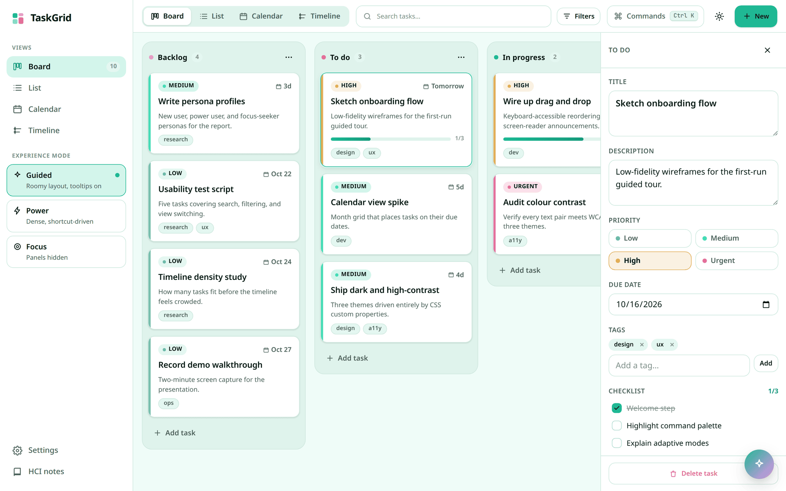

</div>

## Contents

- [Download](#download)
- [Features](#features)
- [Screenshots](#screenshots)
- [Desktop widgets](#desktop-widgets)
- [Adaptive modes](#adaptive-modes)
- [AI assistant](#ai-assistant)
- [Keyboard shortcuts](#keyboard-shortcuts)
- [Accessibility and HCI](#accessibility-and-hci)
- [Running from source](#running-from-source)
- [How it works](#how-it-works)
- [Project structure](#project-structure)

## Download

Grab the latest build from the [Releases page](https://github.com/Rudra-241/TaskGrid/releases/latest).

| Platform | File | Notes |
| --- | --- | --- |
| Windows | `TaskGrid-Setup-<version>.exe` | Installer |
| Windows | `TaskGrid-<version>-portable.exe` | Runs without installing |
| macOS (Apple silicon) | `TaskGrid-<version>-mac-arm64.dmg` | M1 and later |
| macOS (Intel) | `TaskGrid-<version>-mac-x64.dmg` | |
| Linux | `TaskGrid-<version>-linux-x86_64.AppImage` | `chmod +x`, then run |

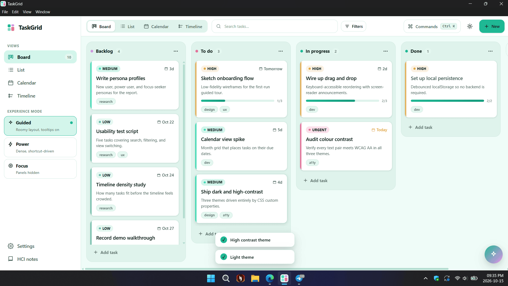
<p align="center"><sub>The desktop app on Windows 11.</sub></p>

> [!NOTE]
> The builds are not code-signed.
> **Windows:** if SmartScreen warns, choose *More info → Run anyway*.
> **macOS:** if it says the app "is damaged" or "can't be opened", move it to Applications and run `xattr -cr /Applications/TaskGrid.app` once.

## Features

- **Four views over one set of tasks:** Kanban board, list, calendar, and timeline. Each answers a different question: what stage is everything in, what is there, what is due when, and what comes next.
- **Rich task cards:** priority, tags, human due dates ("Today", "3d overdue"), descriptions, and checklists with progress.
- **Accessible drag and drop:** move and reorder cards with the pointer *or the keyboard*. Screen readers hear every pick-up, move, and drop.
- **Command palette:** `Ctrl`/`Cmd` + `K` to search actions, switch views, change theme, or jump to a task.
- **AI assistant:** tell it what to do in plain language and it drives the real board through Gemini function calling.
- **Adaptive experience modes:** Guided, Power, and Focus reshape density, panels, and guidance.
- **Three themes:** light, dark, and high contrast, all driven by CSS custom properties.
- **Customizable workspace:** density, which card fields show, panels, tooltips, and animations, all from Settings.
- **Search and filters** by text, priority, and tag without leaving the board.
- **Desktop widgets** for Windows, macOS, and Linux that stay in sync with the app.
- **Local-first:** everything is saved on your device. No account, no server.

## Screenshots

<table>
  <tr>
    <td width="50%">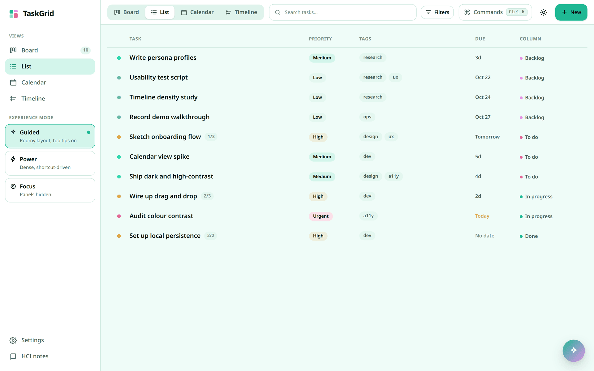<br /><sub><b>List</b>: every task at once, scannable by priority, tags, due date, and column.</sub></td>
    <td width="50%">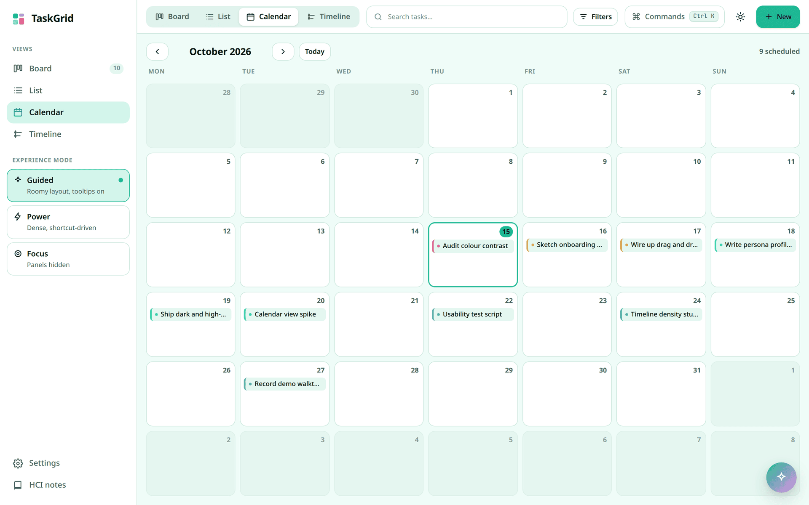<br /><sub><b>Calendar</b>: tasks placed on their due dates, today highlighted.</sub></td>
  </tr>
  <tr>
    <td>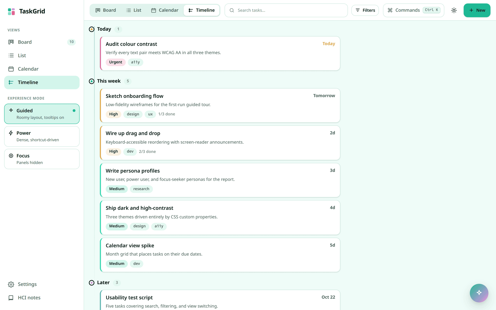<br /><sub><b>Timeline</b>: what is due today, this week, and later, in order.</sub></td>
    <td>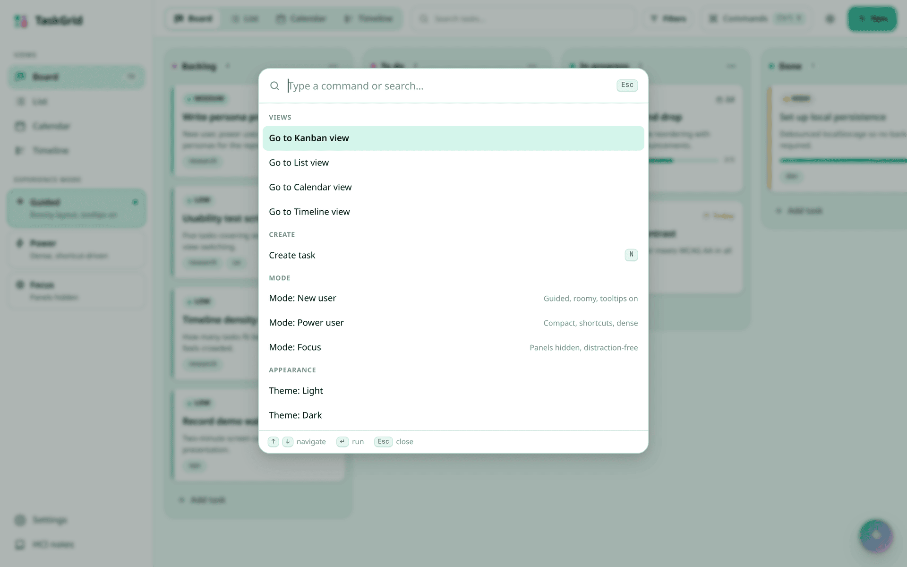<br /><sub><b>Command palette</b>: fuzzy-search every action, recognition over recall.</sub></td>
  </tr>
  <tr>
    <td>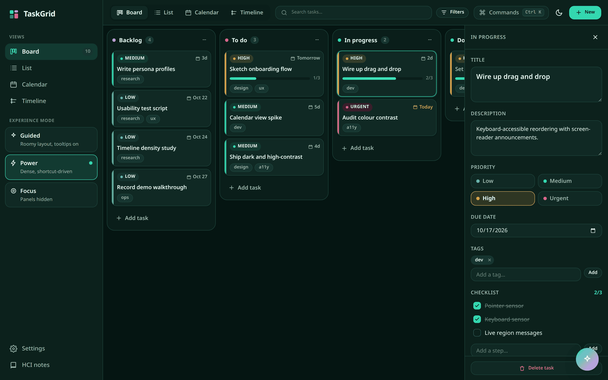<br /><sub><b>Dark theme, Power mode</b>: compact cards for people who live in the tool.</sub></td>
    <td>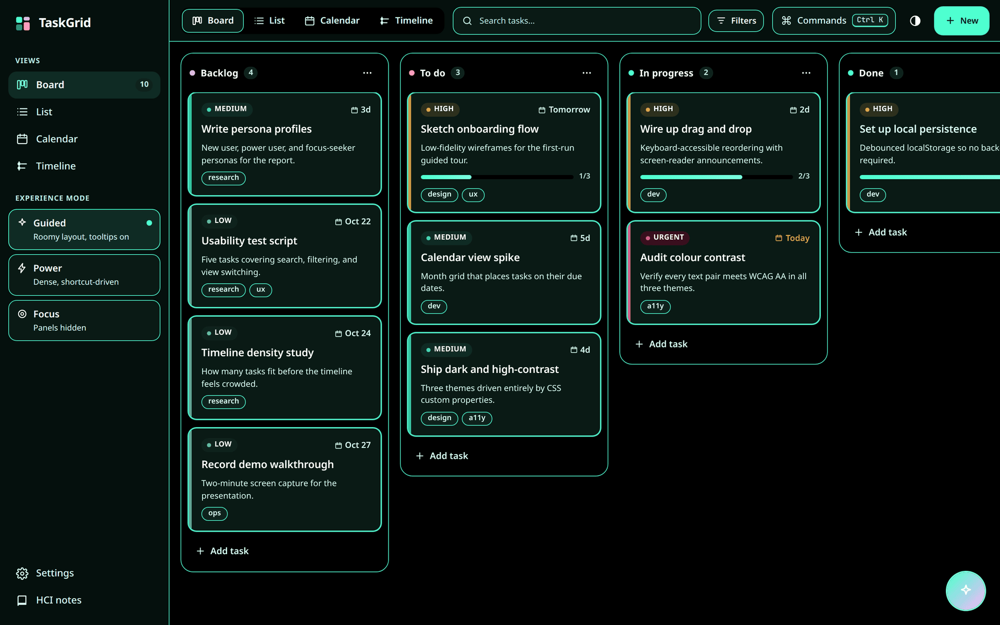<br /><sub><b>High contrast</b>: strong outlines and thicker focus rings.</sub></td>
  </tr>
  <tr>
    <td>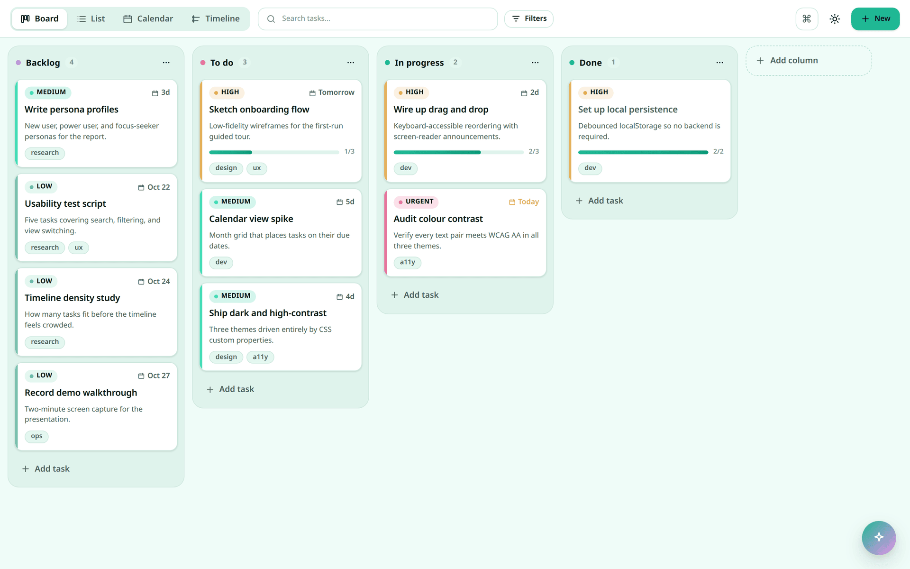<br /><sub><b>Focus mode</b>: sidebar and details hidden, just the work.</sub></td>
    <td>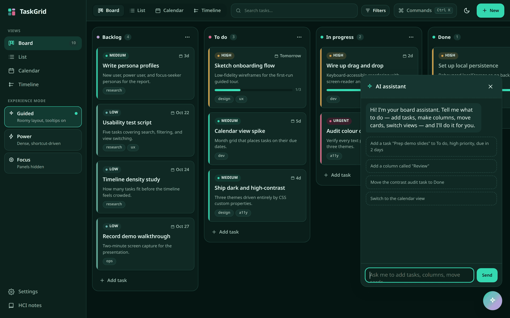<br /><sub><b>AI assistant</b>: natural-language control of the board.</sub></td>
  </tr>
  <tr>
    <td>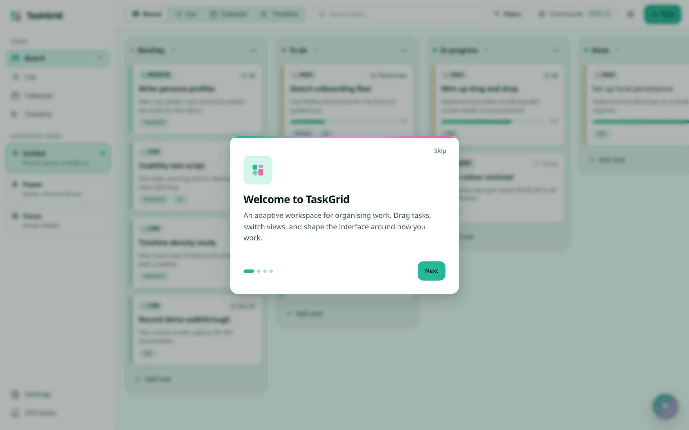<br /><sub><b>Onboarding</b>: a short guided tour on first run.</sub></td>
    <td></td>
  </tr>
</table>

## Desktop widgets

The desktop app adds three small widgets that sit on your desktop and stay in sync with the main window.

<table>
  <tr>
    <td width="50%" align="center">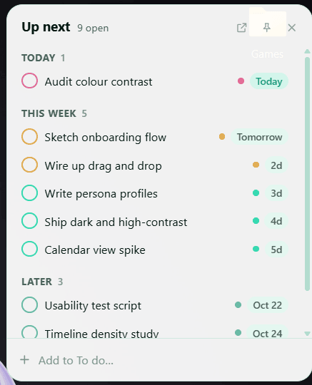<br /><sub><b>Up next</b>, light theme</sub></td>
    <td width="50%" align="center">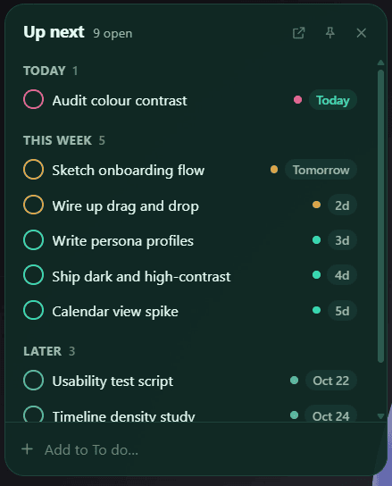<br /><sub><b>Up next</b>, dark theme</sub></td>
  </tr>
  <tr>
    <td>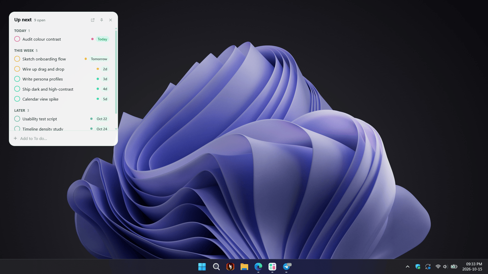</td>
    <td>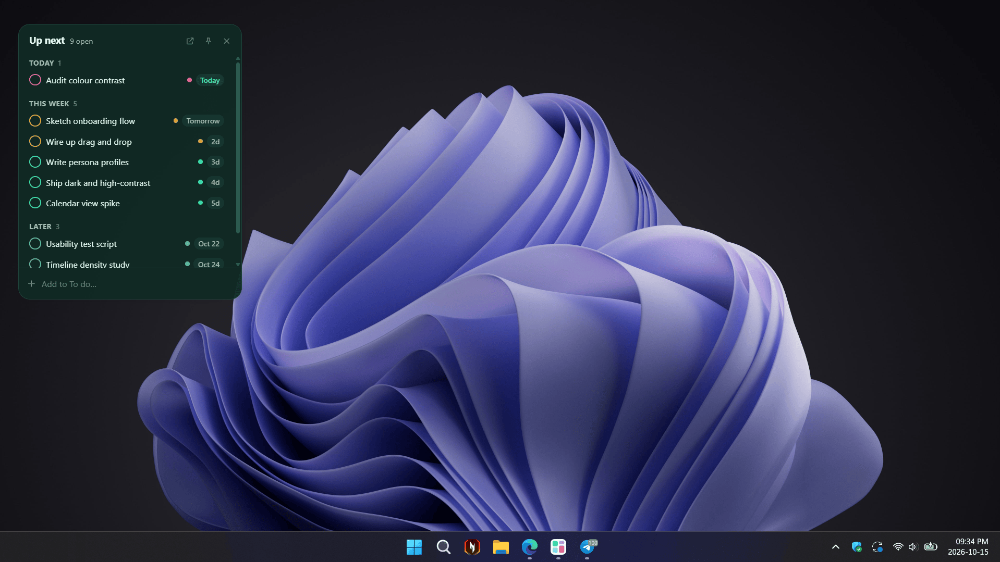</td>
  </tr>
  <tr>
    <td colspan="2" align="center"><sub>On a Windows 11 desktop. Widgets follow the app's theme.</sub></td>
  </tr>
</table>

| Widget | Shows | You can |
| --- | --- | --- |
| **Up next** | Open tasks grouped Overdue, Today, This week, Later, No date | Tick a task done (with a 5-second undo), quick-add a task |
| **Board glance** | Percent done; overdue, due today, next 7 days; tasks per column | See the whole board at a glance |
| **In progress** | Cards in your "In progress" column, with their checklists | Tick checklist items, mark a card done |

- **Click a task title** in any widget to open it in the full app.
- **Drag** a widget anywhere; it remembers its position.
- **Pin** (📌) keeps a widget above other windows; **×** hides it.
- The **tray icon** (Windows/Linux) or **menu-bar icon** (macOS) brings widgets back, turns on **Start at login**, or quits.
- Closing the main window keeps the widgets running. Quit from the tray or menu bar to exit.

Widgets follow the app's theme and update the moment anything changes, in either direction.

## Adaptive modes

Most tools ship one layout and make everyone conform. TaskGrid ships three, each mapped to a persona:

| Mode | For | What changes |
| --- | --- | --- |
| **Guided** | Someone new to the tool | Comfortable density, tooltips on, onboarding |
| **Power** | Someone who lives in it | Compact cards, shortcut hints, dense layout |
| **Focus** | Someone protecting their focus | Sidebar and details hidden, minimal surface |

Switching mode applies sensible defaults; you can still fine-tune each setting afterwards.

## AI assistant

Press `A` (or the ✦ button) to open the assistant. It uses Google Gemini (`gemini-2.5-flash`) with function calling: the model returns structured calls that map onto the app's existing reducer actions, so it changes the real board rather than describing changes. It can create and edit tasks, add checklist items, make and rename columns, move cards, switch views and theme, and filter.

To enable it, open **Settings → AI assistant** and paste a Gemini API key from [aistudio.google.com/apikey](https://aistudio.google.com/apikey). The key is stored only on your device and sent directly to Google.

> [!IMPORTANT]
> Because TaskGrid has no backend, the key lives client-side. That is fine for a personal tool or a study, but a production deployment should proxy the key through a server.

## Keyboard shortcuts

| Keys | Action |
| --- | --- |
| `Ctrl`/`Cmd` + `K` | Open the command palette |
| `/` | Focus search |
| `N` | New task |
| `A` | Open the AI assistant |
| `?` | Show all shortcuts |
| `G` then `B` / `L` / `C` / `T` | Go to board / list / calendar / timeline |
| `Esc` | Close a panel or dialog |

## Accessibility and HCI

TaskGrid is a study piece, so the design reasoning is part of the product. The in-app **HCI notes** page covers the personas, Nielsen's heuristics, the design laws applied (Fitts's, Hick's, Miller's, cognitive load), and the accessibility evaluation.

- **Keyboard-operable drag and drop**, with a live region narrating each step to screen readers.
- **Focus management:** dialogs trap focus and return it on close; there is a skip link.
- **Colour is never the only signal:** priority pairs a colour with a text label; due dates use words, not just colour.
- **High-contrast theme** and **reduced-motion** support (follows the OS setting, or turn animations off in Settings).
- **Error recovery:** completing a task from a widget can be undone.
- **Chunking (Miller's law):** 3 modes, 3 densities, 3 themes, 4 views. No flat list of a dozen options.

## Running from source

Requires Node.js 22 or later.

```bash
git clone https://github.com/Rudra-241/TaskGrid.git
cd TaskGrid
npm install
```

**Web app**

```bash
npm run dev       # dev server at http://localhost:5173
npm run build     # type-check and build to dist/
npm run preview   # serve the production build
npm run lint      # oxlint
```

**Desktop app**

```bash
npm run desktop:dev   # Vite + Electron with hot reload in every window
npm run desktop       # build and run the production desktop app
npm run dist:win      # Windows installer + portable exe (build on Windows)
npm run dist:mac      # macOS .dmg + .zip (build on a Mac)
npm run dist:linux    # Linux AppImage
```

Installers land in `release/`. To preview a widget without Electron, open `http://localhost:5173/widget.html?w=agenda` (or `glance`, `focus`) while the dev server runs.

**Publishing a release:** bump `version` in `package.json`, commit, then push a tag:

```bash
git tag v1.2.0 && git push origin v1.2.0
```

The [Release workflow](.github/workflows/release.yml) builds on Windows, macOS, and Linux runners and attaches every installer to a GitHub Release.

## How it works

- **State:** a single reducer (`src/store/reducer.ts`) owns the board, preferences, and filters. The provider saves it to `localStorage`, debounced so rapid drags don't thrash storage.
- **Sync between windows:** every window listens for `storage` events and adopts board and preference changes made elsewhere, while keeping its own filters and selection. That's how widgets, the main window, and multiple browser tabs stay in step. There is no separate data layer.
- **Desktop shell:** Electron serves the built app over a private `app://` scheme, so the main window and the widgets share one origin and one `localStorage`. Widgets are frameless, transparent windows; a small preload bridge (`window.taskgridDesktop`) lets them open tasks in the main window, pin themselves, or hide.
- **AI:** tool definitions in `src/lib/ai/tools.ts` map onto reducer actions in `src/lib/ai/executeTool.ts`.

## Project structure

```
├── electron/              Desktop shell
│   ├── main.ts            Windows, tray menu, app:// protocol, widget positions
│   └── preload.cts        window.taskgridDesktop bridge
├── src/
│   ├── components/        Cards, inspector, palette, filters, assistant
│   ├── views/             Kanban, list, calendar, timeline
│   ├── shell/             App shell: sidebar, top bar, settings, onboarding
│   ├── store/             Reducer, actions, persistence and cross-window sync
│   ├── widget/            Desktop widgets (Up next, Board glance, In progress)
│   ├── lib/               Formatting, fuzzy search, AI tooling
│   ├── hooks/             Theme, hotkeys, focus trap, media queries
│   └── styles/            Theme tokens and base styles
├── widget.html            Widget entry page
├── build/                 App and tray icons
└── .github/workflows/     Release pipeline
```

## Stack

[React 19](https://react.dev), [TypeScript](https://www.typescriptlang.org), and [Vite](https://vite.dev), with [dnd-kit](https://dndkit.com) for accessible drag and drop, [Framer Motion](https://motion.dev) for microinteractions, [React Router](https://reactrouter.com), [Google Gen AI SDK](https://github.com/googleapis/js-genai) for the assistant, and [Electron](https://www.electronjs.org) with [electron-builder](https://www.electron.build) for the desktop app.
